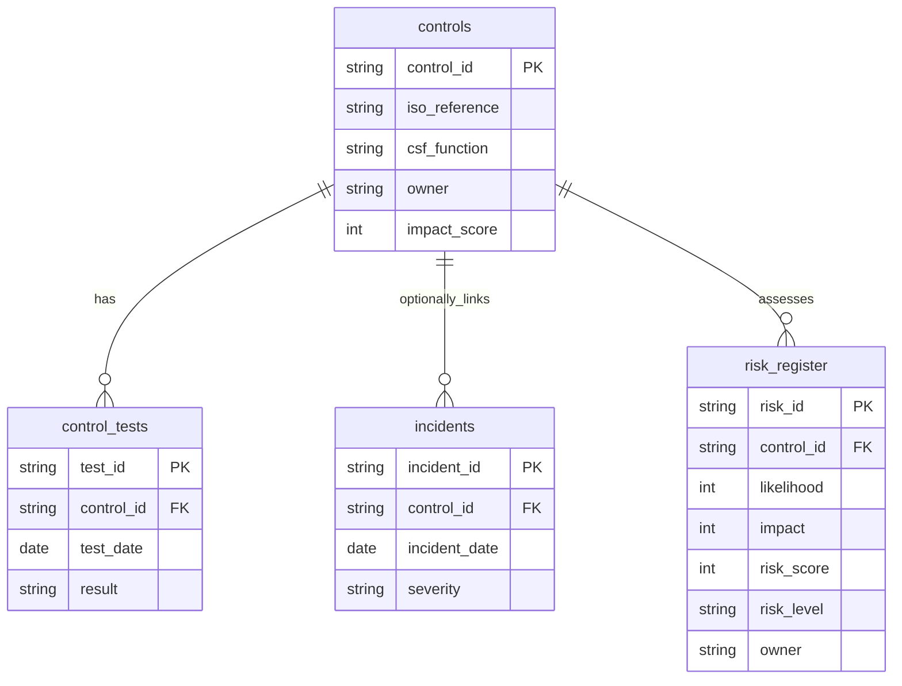

# SYNTHETIC data model

[Design choice] Existing fields and relations preserved; owners are fictional departments. `SYNTHETIC_DATA_DICTIONARY.csv` describes every source column. Risk recalculation occurs in memory, leaving saved ratings intact.

[Fact] Baseline now has 110 linked incidents and zero missing control links. [Design choice] Warn on missing links, reject invalid nonblank foreign keys, include unlinked incidents only when control filters are unrestricted. The type-based synthetic assignments are documented in SYNTHETIC_INCIDENT_LINK_REVIEW.csv.

[Assumption] Existing mapping and impact reasons require review; presence checks do not validate correctness.

[Design choice] Synthetic link repair: fill only previously blank control_id values by incident type (Malware -> CTRL-011; Unauthorized Access -> CTRL-002; Configuration Issue -> CTRL-013; Suspicious Activity -> CTRL-016; Service Disruption -> CTRL-006; Data Exposure -> CTRL-018). These are fictional assignments, not evidence of incident causes. Existing links are unchanged.
[Fact] The link-complete baseline has 17 open High/Critical risks (15 Critical). Health and event totals are unchanged; stored scores match recomputed scores. Earlier baseline results above describe the pre-repair dataset.
